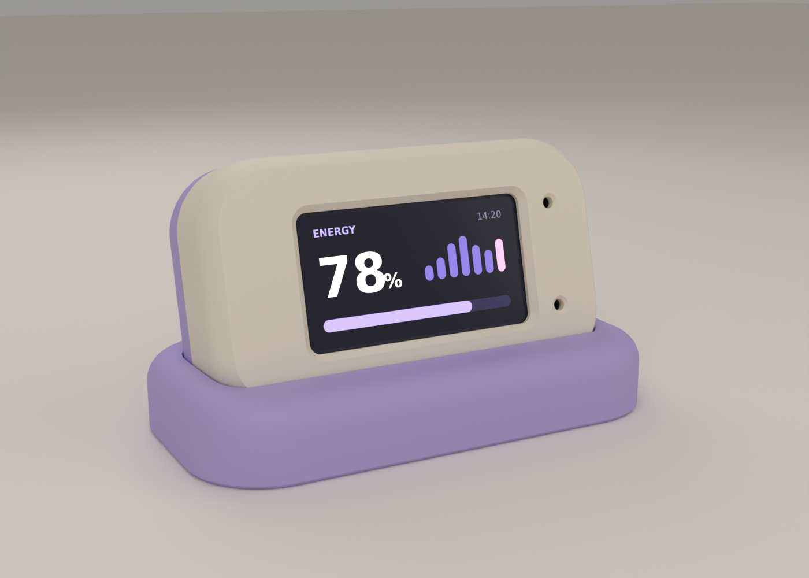

# Desk Energy

A small ESP32 desk display with a Pomodoro timer and an optional energy estimate
from Apple Watch data. The timer works without a phone or Wi-Fi.



*Case concept render, not a photo.* [Case files and printing guide](hardware/case/README.md).

## What it does

- **Tap BOOT** to start, pause or resume. **Hold for 1.5 seconds** to reset.
- Focus for 25 minutes, break for 5, with a 15-minute break after four focuses.
- Shows an energy score, clock and hourly history. A tiny amber clock marks old data.
- Browser controls handle Wi-Fi, tasks, daily focus counts and firmware updates.

The last energy reading and daily count survive a restart. The running timer
and history chart do not.

## Hardware

Ideaspark ESP32-WROOM **16MB** with a **1.9-inch 170×320 ST7789** display,
used in landscape. The case includes a desk dock and monitor mount; check the
fit before printing all the parts.

| Display pin | ESP32 GPIO |
|-------------|------------|
| MOSI / SCLK | 23 / 18 |
| CS / DC | 15 / 2 |
| RESET / Backlight | 4 / 32 |

BOOT uses GPIO0. EN/RST restarts the board.

## Set up the timer

Install [PlatformIO](https://platformio.org/), open this project, then build and
flash from its terminal:

```sh
pio run -t upload
```

1. On first boot, note the access code shown on screen.
2. Join the `DeskFocus-...` Wi-Fi network using that code as the password.
3. Open **http://192.168.4.1/**. Login: **focus**, password: the same code.
4. Enter your **2.4 GHz** Wi-Fi details. Rejoin your usual network, then use
   the device address listed under **Device & wireless updates**.

The setup network reopens if Wi-Fi is lost. You can show the access code again
from the browser. Opening the page also sets your timezone; reopen it after
changing timezones. Keep this HTTP admin page on a trusted LAN—never port-forward it.

For later firmware updates, reset the timer to Ready and upload
`.pio/build/esp32dev/firmware.bin` through the browser. Use that file, not a
bootloader or merged image.

## Add Apple Watch energy data

```text
Apple Watch → Apple Health → Shortcuts → Scriptable → Cloudflare → ESP32
```

You'll need an iPhone, [Scriptable](https://scriptable.app/), a Cloudflare account
and Node.js 24+. The phone and ESP32 can use different networks. The relay uses
Workers and one SQLite-backed Durable Object, available on Cloudflare's Free plan.

### 1. Deploy your relay

Choose a unique Worker name in [relay/wrangler.jsonc](relay/wrangler.jsonc).
Generate two different tokens with `openssl rand -hex 32`, then enter them at
the secret prompts below. Keep them private.

```sh
cd relay
npm ci
npx wrangler login
npx wrangler secret put READ_TOKEN
npx wrangler secret put WRITE_TOKEN
npm run deploy
cd ..
```

Send this as one line over the ESP32's USB serial connection at **115200 baud**,
using your Worker hostname and **READ_TOKEN**:

```json
{"relay":{"host":"WORKER.ACCOUNT.workers.dev","token":"YOUR_64_CHARACTER_READ_TOKEN"}}
```

The display saves these settings and checks for updates every minute.

### 2. Connect the iPhone

1. Copy [Desk Energy.js](tools/scriptable/Desk%20Energy.js) into Scriptable.
   Name it **Desk Energy** and set its `relayURL` to your Worker's HTTPS
   `/v1/energy` URL.
2. Run the script once and enter **WRITE_TOKEN** when asked. It saves the token
   in Scriptable's Keychain.
3. Build the Health-reading Shortcut on a Mac:

   ```sh
   node tools/shortcuts/build-sync.mjs
   shortcuts sign --mode anyone \
     --input tools/shortcuts/health-data.unsigned.shortcut \
     --output "tools/shortcuts/Desk Energy Health Data.shortcut"
   ```

4. AirDrop the signed file to your iPhone and add it to Shortcuts. Check its
   Health queries are **Heart Rate Variability**, **Resting Heart Rate** and
   **Active Calories**.
5. After the final **Text** action, add **Scriptable → Run Script**. Choose
   **Desk Energy**, set **Parameter** to **Text**, and turn **Run in App off**.
6. Run it unlocked once and grant permissions. If sharing is blocked, enable
   **Settings → Apps → Shortcuts → Advanced → Allow Sharing Large Amounts of Data**.
   This setting affects all Shortcuts, so only run ones you trust.

For automatic updates, create daily **Time of Day** automations at each hour
from **06:00 to 18:00 inclusive**, using **Run Immediately** and this Shortcut.
That's 13 separate schedules. Locked-phone execution depends on iOS and hasn't
been verified for this setup.

## About the score

It's a rough estimate, **not a medical measurement or a validated focus score**.
The [calculation](relay/src/model.ts) compares HRV and resting heart rate with
personal baselines, requiring seven days of history and observations within
36 hours. It subtracts for activity and time since the day's first estimate—not
actual waking time. It doesn't currently model sleep, circadian rhythm or cycles.

Readings become stale after two hours and expire within six hours, or at local
midnight. A new upload containing old Watch measurements is still old data.

Raw Health history stays on the phone. Only a summary goes to Cloudflare over
HTTPS; Cloudflare can process it, so this is not end-to-end encryption.
Tokens and saved readings on the ESP32 are not encrypted at rest.

## Development

```sh
sh tools/test_host.sh
cd relay
npm run check
npm test
```

Serial commands: `s` start, `p` pause, `r` reset, `n` skip, `t` status, `?` help.
Optional computer build/test reporting: `python3 tools/desk_focus.py --help`.

## License

[MIT](LICENSE) © 2026 Desk Energy contributors.
[Font and dependency notices](THIRD_PARTY_NOTICES.md) apply separately.
